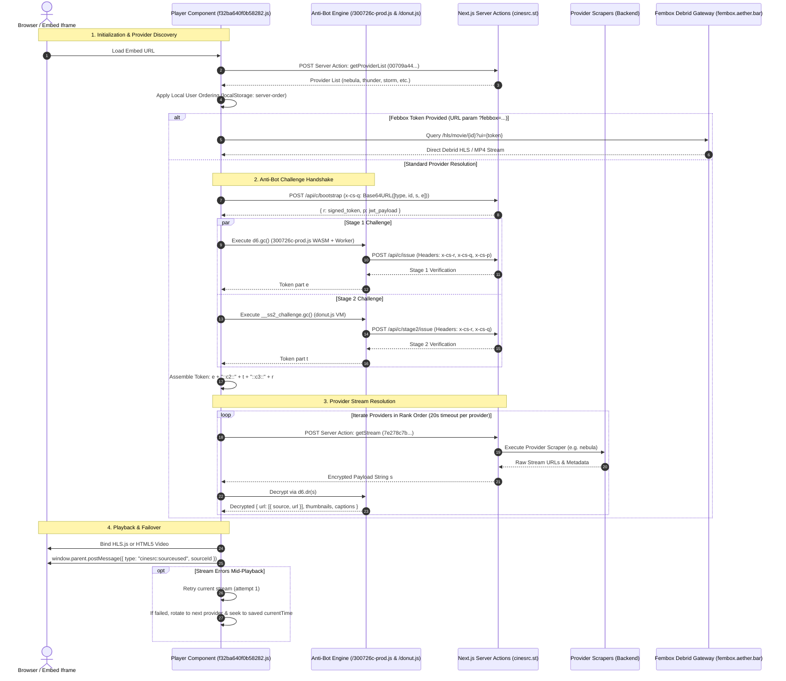

# CineSrc Player Reverse Engineering & Provider Architecture Specification

> **Target Analyzed**: `https://cinesrc.st/embed/movie/969681?color=%239b5cff&controls=true&continueprompt=true`  
> **Investigation Date**: October 2026  
> **Tooling**: Antigravity REA MCP (`analyze_javascript_application`), Static Decompilation & Network Validation  
> **Evidence Reference**: `ev_9baee8750327fdc992f340ba7616f529a3bc4761057661b9326fa0c78ef97c9a`

---

## 1. Executive Summary

CineSrc (`cinesrc.st`) operates a multi-provider video embed service built on **Next.js (App Router / Turbopack)**. The frontend player serves as an intelligent, client-side orchestrator that coordinates:
- Dynamic provider discovery and rank-ordered failover.
- Multi-tier cryptographic anti-bot challenge verification (WebAssembly, WebWorkers, and bytecode virtual machines).
- Server-side scraping executed through Next.js Server Actions.
- Client-side stream payload decryption via WebCrypto.
- Resilient stream failover with seamless playback timestamp preservation (`currentTime`).
- Bidirectional parent iframe communication via `postMessage`.

---

## 2. End-to-End System Architecture



---

## 3. Provider System & Discovery

### 3.1. Provider Discovery Server Action
The client fetches the live list of available providers using Next.js Server Actions:
- **Action Identifier**: `00709a44ddb018c921339ab3213396ad85c0dc0237` (`getProviderList`)
- **Invocation**:
  ```bash
  curl -X POST "https://cinesrc.st/embed/movie/969681" \
    -H "Next-Action: 00709a44ddb018c921339ab3213396ad85c0dc0237" \
    -H "Content-Type: application/json" \
    -d "[]"
  ```
- **Observed Provider Inventory**:
  ```json
  [
    {"id":"nebula",   "name":"⭐️ Nebula",      "rank":120, "flags":["us"]},
    {"id":"thunder",  "name":"Thunder",        "rank":110, "flags":["us"]},
    {"id":"storm",    "name":"Storm",          "rank":110, "flags":["us"]},
    {"id":"wave",     "name":"Wave",           "rank":88,  "flags":["us"]},
    {"id":"surge",    "name":"Surge",          "rank":87,  "flags":["us"]},
    {"id":"blizzard", "name":"Blizzard",       "rank":85,  "flags":["us"]},
    {"id":"pulse",    "name":"Pulse",          "rank":85,  "flags":["us"]},
    {"id":"aurora",   "name":"Aurora",         "rank":85,  "flags":["us"]},
    {"id":"rush",     "name":"Rush",           "rank":81,  "flags":["us"]},
    {"id":"mist",     "name":"Mist",           "rank":80,  "flags":["us"]},
    {"id":"paris",    "name":"Paris (FR&ENG)", "rank":72,  "flags":["fr"]},
    {"id":"sturm",    "name":"Sturm",          "rank":62,  "flags":["de"]},
    {"id":"brisa",    "name":"Brisa (ES/LAT)", "rank":62,  "flags":["mx"]}
  ]
  ```

### 3.2. Local User Ordering & Re-indexing
The player supports drag-and-drop provider reordering in the settings UI.
- Stored Key: `localStorage.getItem("server-order")` (array of provider IDs).
- Sorting Algorithm (`d0(providers, savedOrder)`):
  Reorders the fetched list according to user preferences while computing optimal insertion indices for any new servers introduced by the backend.

### 3.3. Febbox Debrid Gateway
When the URL contains `?febbox=<token>`, two custom providers are prepended:
- `febbox-hls` (Rank: `-2`)
- `febbox-mp4` (Rank: `-1`)

These bypass server-side scrapers and query the Fembox proxy directly:
```http
# Movie HLS
GET https://fembox.aether.bar/hls/movie/{tmdbId}?ui={febboxToken}

# TV Show HLS
GET https://fembox.aether.bar/hls/tv/{tmdbId}/{season}/{episode}?ui={febboxToken}

# Direct MP4
GET https://fembox.aether.bar/movie/{tmdbId}?ui={febboxToken}
```

---

## 4. Multi-Stage Anti-Bot Challenge Pipeline

All standard provider scraping requests are protected behind a multi-tier challenge verification pipeline.

```
       [mediaType, tmdbId, s, e]
                  │
                  ▼
         Base64URL encode
                  │
                  ▼
         POST /api/c/bootstrap
         Header: x-cs-q: <payload>
                  │
       ┌──────────┴──────────┐
       ▼                     ▼
r (signed token)      p (timestamp JWT)
       │                     │
       ├─────────────────────┼─────────────────────┐
       ▼                                           ▼
[Stage 1: 300726c-prod.js]              [Stage 2: donut.js]
• Embedded WebAssembly                 • Obfuscated VM bytecode
• Dedicated WebWorker                  • Environment integrity checks
• POST /api/c/issue                    • POST /api/c/stage2/issue
• Headers: x-cs-r, x-cs-q, x-cs-p      • Headers: x-cs-r, x-cs-q
• Generates: token `e`                 • Generates: token `t`
       │                                           │
       └─────────────────────┬─────────────────────┘
                             │
                             ▼
              challengeToken = `${e}::c2::${t}::c3::${r}`
```

### Stage Breakdown:
1. **Bootstrap Handshake (`/api/c/bootstrap`)**:
   - Client sends base64url-encoded JSON array `[type, id, season, episode]`.
   - Server returns `{ v: 1, r: "<signed_token>", p: "<jwt>" }`.
2. **Stage 1 Challenge Script (`/300726c-prod.js`)**:
   - Size: ~147 KB.
   - Registers itself by dispatching a custom DOM event `_cs` with a dynamic window property reference.
   - Instantiates an embedded **WebAssembly** module and spawns an inline **WebWorker**.
   - Monkey-patches `window.fetch` to inject `x-cs-r`, `x-cs-q`, and `x-cs-p` into `/api/c/issue`.
   - Method `d6.gc()` returns challenge fragment `e`.
3. **Stage 2 Challenge Script (`/donut.js`)**:
   - Size: ~39 KB.
   - Custom interpreter loop with opcode dispatching table.
   - Defines `window.__ss2_challenge`.
   - Monkey-patches `window.fetch` to inject `x-cs-r` and `x-cs-q` into `/api/c/stage2/issue`.
   - Method `window.__ss2_challenge.gc()` returns challenge fragment `t`.
4. **Final Challenge Token**:
   Combined into a single composite string: `${e}::c2::${t}::c3::${d}`.

---

## 5. Stream Resolution & Decryption

### 5.1. The `getStream` Server Action
- **Action Identifier**: `7e278c7b1a4440a99a81b5c121b5f93193ce0a3f64` (`getStream`)
- **Invocation Arguments**:
  ```json
  [
    "969681",              // Media TMDB ID
    "movie",               // "movie" | "show"
    null,                  // Season (null for movie)
    null,                  // Episode (null for movie)
    "<challengeToken>",    // Multi-stage token
    "nebula"               // Target Provider ID
  ]
  ```

### 5.2. Challenge Validation & Retries
- If the token is invalid or expired, the action returns string literal: `"e1:invalid_challenge"`.
- The player catches this and immediately triggers a fresh challenge generation cycle (maximum 2 attempts).

### 5.3. Payload Decryption
When successful, the server returns an encrypted string `s`.
The client invokes the Stage 1 WebCrypto/WASM decryption routine:
```javascript
let decrypted = await d6.dr(s);
```
Decrypted object specification:
```typescript
interface DecryptedStreamResponse {
  url: Array<{
    source: string;  // e.g. "HLS", "1080p", "720p", "4k"
    url: string;     // Streaming URL (.m3u8 manifest or direct MP4)
  }>;
  thumbnails?: string; // WebVTT sprite sheet URL (e.g. "https://.../thumbnails.vtt")
  captions?: Array<{
    url: string;      // VTT / SRT subtitle track URL
    language: string; // ISO 639-1 language code (e.g. "en")
    label: string;    // Display title (e.g. "English [CC]")
  }>;
}
```

---

## 6. Playback Failover & Recovery Mechanism

The player contains a fault-tolerant recovery loop designed to minimize user interruption.

```
       Active Playback
              │
         Stream Error
       (<video onError> or HLS fatal)
              │
              ▼
   Is this attempt 1 on URL?
        ┌─────┴─────┐
      YES           NO
        │           │
        ▼           ▼
   Fast Retry   Multi-Server Failover
   (Keep URL,   • Rotate provider list starting at (failedIdx + 1)
    seek to     • Iterate each provider with 20s timeout
    saved time) • When found: swap stream & seek to saved time
                • Notify parent: postMessage("cinesrc:sourceused")
```

### Key Recovery Mechanics:
1. **20-Second Per-Provider Timeout**:
   Every provider resolution is wrapped in a deadline promise:
   ```javascript
   await vQ(resolveProvider(providerId), 20000, `${providerId} did not respond within 20 seconds`);
   ```
2. **Two-Level Error Handling**:
   - **Level 1 (Transient glitch)**: First error on an active stream triggers an instant reload of the current stream without switching providers.
   - **Level 2 (Dead provider failover)**: Subsequent failure marks the provider as `"failed"`, rotates the provider list starting from the server immediately after the failed one (`[...providers.slice(s + 1), ...providers.slice(0, s)]`), and tests each provider sequentially.
3. **Seamless Time Preservation**:
   The player continuously records `currentTime`. Upon successfully switching to a new provider, it automatically restores the timestamp (`v.current > 0 && setPendingSeekTime(v.current)`), preventing the viewer from losing their place.

---

## 7. Parent Embed API & PostMessage Protocol

The embed supports complete headless or iframe integration through URL query parameters and `window.postMessage`.

### 7.1. Query Parameters

| Parameter | Type | Default | Description |
| :--- | :--- | :--- | :--- |
| `color` | string | `#3b82f6` | Hex theme color (e.g. `%23f5a623` for Evolix Gold). |
| `controls` | boolean | `true` | Show or hide custom player controls. |
| `autoplay` | boolean | `false` | Enable automatic video playback. |
| `muted` | boolean | `false` | Start playback in muted state. |
| `seek` / `t` | number | `0` | Initial start timestamp in seconds. |
| `continueprompt` | boolean | `false` | Display "Resume watching" modal if progress exists. |
| `prioritize` | boolean | `false` | Prioritize a designated server. |
| `lastserver` | string | `null` | Provider ID to prioritize (e.g. `lastserver=nebula`). |
| `febbox` | string | `null` | User UI token for Febbox debrid streaming. |
| `da` | boolean | `false` | Disable ad popups / redirects. |
| `back` | string | `null` | Back button action (URL or `"close"` for postMessage). |

### 7.2. Outbound Events (`window.parent.postMessage`)

| Event Type | Payload | Trigger Condition |
| :--- | :--- | :--- |
| `cinesrc:ready` | `{}` | Player DOM and controller are ready. |
| `cinesrc:sourceused` | `{ sourceId: string }` | Stream resolved (e.g. `{ sourceId: "nebula" }`). |
| `cinesrc:play` | `{}` | Playback resumed. |
| `cinesrc:pause` | `{}` | Playback paused. |
| `cinesrc:timeupdate` | `{ currentTime: number, duration: number }` | Playback position update. |
| `cinesrc:seeking` | `{ currentTime: number }` | User initiated seek. |
| `cinesrc:seeked` | `{ currentTime: number }` | Seek operation completed. |
| `cinesrc:ended` | `{}` | Video reached end of stream. |
| `cinesrc:volumechange` | `{ volume: number, muted: boolean }` | Audio volume or mute state altered. |
| `cinesrc:skipintro` | `{ time: number }` | Intro skipped to designated timestamp. |
| `cinesrc:nextepisode` | `{ season: number, episode: number, internalNavigation: true, source: string }` | Auto-next or user triggered next episode. |
| `cinesrc:close` | `{}` | Back button clicked with `back=close`. |

### 7.3. Inbound Commands (`window.postMessage`)
Host pages can control the player by posting messages:
```javascript
iframeElement.contentWindow.postMessage({
  type: "cinesrc:command",
  command: "play", // "play" | "pause" | "getCurrentTime" | "getDuration" | "getVolume"
  args: []
}, "*");
```

---

## 8. Strategic Integration Guides for Evolix 2.0 & Evo-Engine

### Strategy A: Evolix 2.0 Branded Fallback Player (Direct Embed)
Use CineSrc as an instant on-demand fallback within Evolix 2.0 when a media item has not yet been ingested locally:

```tsx
// app/components/player/CineSrcEmbed.tsx
"use client";

import { useEffect, useRef } from "react";

interface CineSrcEmbedProps {
  tmdbId: number;
  mediaType: "movie" | "tv";
  season?: number;
  episode?: number;
  onTimeUpdate?: (currentTime: number, duration: number) => void;
  onEnded?: () => void;
}

export function CineSrcEmbed({
  tmdbId,
  mediaType,
  season,
  episode,
  onTimeUpdate,
  onEnded,
}: CineSrcEmbedProps) {
  const iframeRef = useRef<HTMLIFrameElement>(null);

  // URL matching Evolix Gold (#f5a623)
  const embedUrl = new URL(
    mediaType === "movie"
      ? `https://cinesrc.st/embed/movie/${tmdbId}`
      : `https://cinesrc.st/embed/tv/${tmdbId}`
  );
  embedUrl.searchParams.set("color", "#f5a623");
  embedUrl.searchParams.set("controls", "true");
  embedUrl.searchParams.set("continueprompt", "true");
  embedUrl.searchParams.set("da", "true"); // Disable ads
  if (season) embedUrl.searchParams.set("s", String(season));
  if (episode) embedUrl.searchParams.set("e", String(episode));

  useEffect(() => {
    const handleMessage = (event: MessageEvent) => {
      if (!event.data?.type) return;

      switch (event.data.type) {
        case "cinesrc:timeupdate":
          onTimeUpdate?.(event.data.currentTime, event.data.duration);
          break;
        case "cinesrc:ended":
          onEnded?.();
          break;
        case "cinesrc:sourceused":
          console.log(`[Evolix] Active CineSrc provider: ${event.data.sourceId}`);
          break;
      }
    };

    window.addEventListener("message", handleMessage);
    return () => window.removeEventListener("message", handleMessage);
  }, [onTimeUpdate, onEnded]);

  return (
    <iframe
      ref={iframeRef}
      src={embedUrl.toString()}
      className="w-full h-full border-0 bg-black"
      allow="autoplay; fullscreen; encrypted-media; picture-in-picture"
      allowFullScreen
    />
  );
}
```

### Strategy B: Headless Stream Extraction in `evo-engine`
To extract the raw `.m3u8` manifest for playback in Evolix's native Vidstack player without exposing CineSrc's iframe:

1. **Lightweight Headless Interceptor (Playwright)**:
   Because the anti-bot tokens are generated via WebAssembly/VM, run an isolated headless page in `tools/evo-engine`:
   ```python
   # tools/evo-engine/app/services/cinesrc_extractor.py
   from playwright.async_api import async_playwright

   class CineSrcExtractor:
       async def extract_stream(self, tmdb_id: int, media_type: str = "movie") -> str:
           embed_url = f"https://cinesrc.st/embed/{media_type}/{tmdb_id}?controls=false&autoplay=true&da=true"
           
           async with async_playwright() as p:
               browser = await p.chromium.launch(headless=True)
               page = await browser.new_page()
               
               m3u8_url = None

               # Intercept network requests for m3u8 playlists
               async def on_request(request):
                   nonlocal m3u8_url
                   url = request.url
                   if ".m3u8" in url and not m3u8_url:
                       m3u8_url = url

               page.on("request", on_request)
               await page.goto(embed_url, wait_until="domcontentloaded")
               
               # Wait up to 15 seconds for playback resolution
               for _ in range(30):
                   if m3u8_url:
                       break
                   await page.wait_for_timeout(500)
                   
               await browser.close()
               return m3u8_url
   ```
2. **Proxying via `hls_proxy.py`**:
   Feed the extracted `.m3u8` URL through `app/services/hls_proxy.py` to strip referrer checks and forward segments to Vidstack seamlessly.

---

## 9. Conclusion & Investigation Checklist

- [x] **Provider Discovery**: Documented Server Action `00709a44...` and complete provider list.
- [x] **Anti-Bot Mechanism**: Decoded `/api/c/bootstrap`, `/300726c-prod.js` (WASM/Worker), and `/donut.js` (VM).
- [x] **Stream Resolution**: Documented Server Action `7e278c7b...` and client-side `d6.dr(s)` decryption.
- [x] **Failover Logic**: Analyzed 20s per-server timeout, Level 1 instant retry, and Level 2 list rotation.
- [x] **Integration Options**: Detailed iframe PostMessage protocol and Python headless extraction pipeline.
