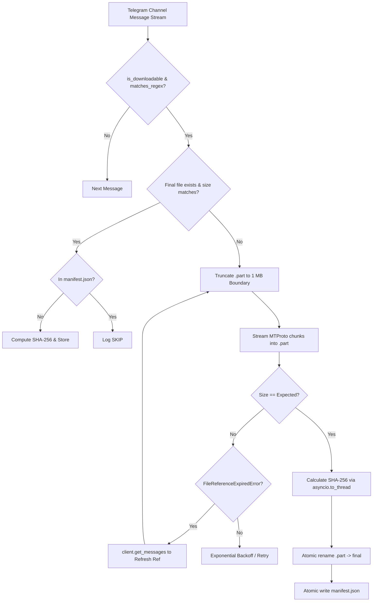

# Architecture and Technical Reference

This document explains the internal mechanisms, reliability guarantees, transfer pipelines, and data structures across the Evolix media tooling suite.

---

## 1. Telegram Transfer Pipeline



---

## 2. 1 MB Chunk-Aligned Resume

Telegram MTProto protocol enforces block alignment on file transfers.

1. When a download is interrupted, a `<file>.part` remains on disk.
2. Upon restart, the script calculates:
   ```python
   offset = (part.stat().st_size // CHUNK) * CHUNK
   ```
3. Any trailing fractional megabyte is truncated, ensuring the byte offset sent to `client.iter_download(...)` aligns cleanly with Telegram's chunk boundaries (`CHUNK = 1024 * 1024`).

---

## 3. MTProto File Reference Expiration & Auto-Refresh

Telegram's MTProto protocol issues ephemeral `file_reference` tokens embedded within media message objects. These tokens expire after approximately 2 hours.

When processing large batches of media or resuming after a delay:
1. Long-running transfers trigger a `telethon.errors.FileReferenceExpiredError`.
2. Rather than crashing or aborting the queue, `tg_downloader.py` and `run_50_pipeline.py` catch `FileReferenceExpiredError`.
3. The script calls:
   ```python
   refreshed = await client.get_messages(entity, ids=msg.id)
   ```
4. The fresh message object with updated file reference replaces the stale reference in-memory.
5. Transfer resumes seamlessly from the current 1 MB boundary without restarting from 0 bytes.

---

## 4. Transient Storage & Zero-Disk Accumulation

When ingesting large numbers of high-definition movies (e.g. 50+ movies totaling ~50-100 GB) onto a virtual private server with limited local NVMe storage, keeping all downloaded media locally will quickly lead to `ENOSPC` (disk full) errors.

The automated pipeline (`run_50_pipeline.py`) implements a transient single-slot buffer pattern:

```mermaid
flowchart LR
    subgraph Disk Footprint: 1 Active Slot (< 2 GB)
        TG[Telegram MTProto] -->|Stream Chunk| LocalPart[file.part]
        LocalPart -->|Finalize| LocalFile[file.mkv]
        LocalFile -->|Stream PUT| PxDrain[Pixeldrain Cloud]
        PxDrain -->|Link Source| EvolixCMS[Evolix Platform]
        EvolixCMS -->|Unlink| CleanDisk[os.unlink file.mkv]
    end
    CleanDisk -->|Next Item| TG
```

- **Single Slot Invariant**: Only one video file exists on disk at any point in time.
- **Memory Generator Streaming**: `upload_pixeldrain.py` and `run_50_pipeline.py` use a custom `ProgressReader` generator that streams bytes directly into HTTP requests, avoiding reading full multi-gigabyte video files into RAM.
- **Immediate Cleanup**: Once Pixeldrain confirms HTTP 201 Created and Evolix attaches the direct streaming source, `target_path.unlink()` is invoked immediately before requesting the next item.

---

## 5. Atomic Integrity Safeguards

To prevent corruption from unexpected power loss, kill signals, or network disconnects:

- **Files**: Downloaded entirely to `<filename>.part`. Only upon complete transmission and size verification is `os.replace(part, final)` called.
- **Manifests**: Saved through temporary swap (`manifest.json.tmp` -> `os.replace` -> `manifest.json`).
- **Non-blocking Hashing**: `asyncio.to_thread(sha256_file, ...)` runs file hashing in a worker thread pool, preventing CPU spikes from starving the asyncio event loop.

---

## 6. Manifest File Structures

### Telegram Downloader (`manifest.json`)
Each record is keyed by the Telegram message ID:
```json
{
  "3": {
    "name": "3_Better.Call.Saul.S01E01.720p.BluRay.x265.10bit.mkv",
    "size": 304087040,
    "sha256": "8bcbcea0b9713415c1f07b8611321c577116feb0b1e9fa547054a2c123a79039"
  }
}
```

### Pixeldrain Uploader (`pixeldrain_uploads.json`)
```json
{
  "list_title": "Better Call Saul - Season 1",
  "list_id": "MmBydsuB",
  "list_url": "https://pixeldrain.com/l/MmBydsuB",
  "total_files": 10,
  "total_size_bytes": 3145728000,
  "files": [
    {
      "name": "3_Better.Call.Saul.S01E01.720p.mkv",
      "size": 304087040,
      "id": "abc12345",
      "url": "https://pixeldrain.com/u/abc12345",
      "download_url": "https://pixeldrain.com/api/file/abc12345?download",
      "uploaded_at": "2026-10-11T03:59:12.123456+00:00",
      "type": "video"
    }
  ]
}
```

### Pipeline Progress (`pipeline_50_progress.json`)
```json
{
  "completed": [
    {
      "tmdb_id": 1184918,
      "title": "The Wild Robot",
      "year": 2024,
      "movie_id": "cm2...",
      "source_id": "cm2...",
      "pixeldrain_id": "xyz789",
      "pixeldrain_url": "https://pixeldrain.com/u/xyz789",
      "quality": "720p",
      "completed_at": "2026-10-11T08:15:20Z"
    }
  ]
}
```

---

## 7. Error Recovery & Backoff Strategy

- **`FloodWaitError`**: When Telegram triggers a rate limit, the script sleeps for `e.seconds + 1` before resuming.
- **`FileReferenceExpiredError`**: Re-fetches the channel entity and message to refresh the expired MTProto token.
- **Pixeldrain 429**: Sleeps for 15 seconds before retrying.
- **`errno.ENOSPC`**: Halts immediately with a critical alert to avoid filling the disk with failing retry attempts.
- **Transient Network Errors**: Employs exponential backoff (`delay = min(2 ** attempt, 60)`).
