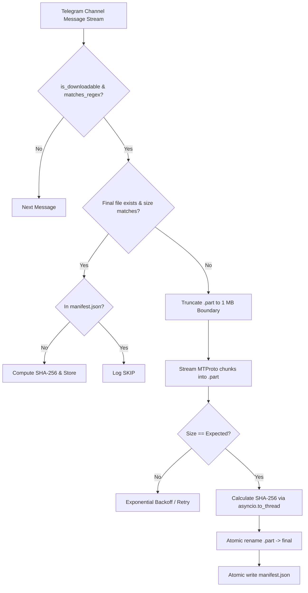

# Architecture and Technical Reference

This document explains the internal mechanisms, reliability guarantees, and file format structures of `tg_downloader.py`.

---

## 1. Transfer Pipeline



---

## 2. 1 MB Chunk-Aligned Resume

Telegram MTProto protocol enforces block alignment on file transfers.

1. When a download is interrupted, a `<file>.part` remains on disk.
2. Upon restart, the script calculates:
   ```python
   offset = (part.stat().st_size // CHUNK) * CHUNK
   ```
3. Any trailing fractional megabyte is truncated, ensuring the byte offset sent to `client.iter_download(...)` aligns cleanly with Telegram's chunk boundaries (`CHUNK = 1024 * 1024`).

---

## 3. Atomic Integrity Safeguards

To prevent corruption from unexpected power loss or crashes:

- **Files**: Downloaded entirely to `<filename>.part`. Only upon complete transmission and size verification is `os.replace(part, final)` called.
- **Manifest**: Saved through temporary swap (`manifest.json.tmp` -> `os.replace` -> `manifest.json`).
- **Non-blocking Hashing**: `asyncio.to_thread(sha256_file, ...)` runs file hashing in a worker thread pool, preventing CPU spikes from starving the asyncio event loop.

---

## 4. `manifest.json` Structure

Each record is keyed by the Telegram message ID:

```json
{
  "3": {
    "name": "3_Better.Call.Saul.S01E01.720p.BluRay.x265.10bit.mkv",
    "size": 304087040,
    "sha256": "8bcbcea0b9713415c1f07b8611321c577116feb0b1e9fa547054a2c123a79039"
  }
}
```

---

## 5. Error Recovery

- **`FloodWaitError`**: When Telegram triggers a rate limit, the script sleeps for `e.seconds + 1` before resuming.
- **`errno.ENOSPC`**: Halts immediately with a critical alert to avoid filling the disk with failing retry attempts.
- **Transient Network Errors**: Employs exponential backoff (`delay = min(2 ** attempt, 60)`).
