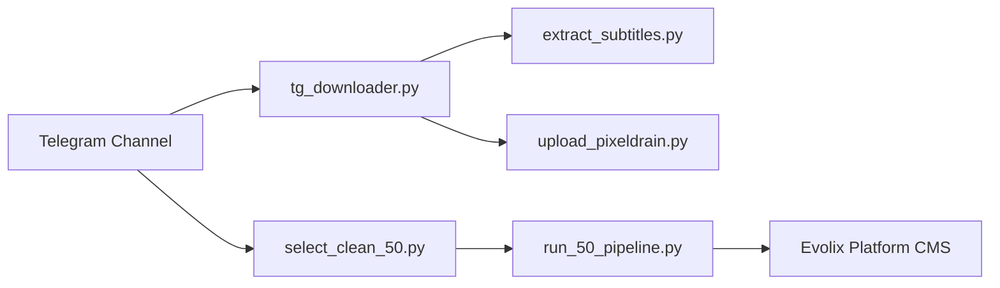

# Evolix 2.0 Media Tooling & Automation Suite

Welcome to the documentation for the **Evolix 2.0 Media Tooling & Automation Suite**, a production-grade collection of Python utilities designed to discover, download, process, curate, host, and ingest media assets into the Evolix streaming platform.

---

## Suite Components

- **Telegram Media Downloader (`tg_downloader.py`)**: High-performance, resumable MTProto media fetcher featuring 1 MB chunk-aligned transfers, ephemeral file reference renewal, regex/search/ID filters, and SHA-256 integrity verification.
- **Subtitle Extractor (`extract_subtitles.py`)**: Automated MKV/MP4 stream inspector and extractor producing standalone `.srt`, `.vtt`, or `.ass` files via `ffmpeg`/`ffprobe`.
- **Pixeldrain CRUD Suite (`upload_pixeldrain.py`)**: Complete CRUD command-line manager for Pixeldrain: upload files/directories, search remote assets by keyword or regex, inspect metadata, download files, create/update/delete album lists, and delete files with safety prompts.
- **Candidate Curator & Validator (`select_clean_50.py`)**: Cleans noisy channel filenames, strips TV episode duplicates, queries Evolix's TMDB search proxy, and verifies feature film duration and poster availability.
- **Automated Ingestion Pipeline (`run_50_pipeline.py`)**: Complete 5-stage orchestration pipeline that pulls movies from Telegram, uploads to Pixeldrain, publishes to the Evolix platform, attaches direct streaming sources, and unlinks local files immediately to operate with near-zero disk overhead.

---

## Key Highlights

- **Resumable Transfers**: Partial downloads are saved as `.part` files and resumed from the nearest 1 MB boundary without restarting from zero.
- **Auto-Renewing File References**: Transparently manages Telegram `FileReferenceExpiredError` on long multi-hour batches, re-fetching message references on the fly.
- **Zero Local Disk Exhaustion**: The automated pipeline uses a transient single-slot buffer pattern, immediately cleaning up local video files after cloud upload and platform publishing.
- **CORS Direct Streaming**: Integrates with Pixeldrain direct endpoints supporting HTTP byte-ranges and CORS headers, enabling instant streaming in HTML5 / Vidstack players.
- **Fault-Tolerant**: Transparently manages Telegram `FloodWaitError` rate limits, exponential backoff on network dropouts, Evolix session token refreshes, and halts safely on disk exhaustion (`ENOSPC`).

---

## Documentation Sections

1. [Setup and Configuration](setup.md)
   - Telegram MTProto API credentials acquisition
   - Virtual environment and dependency installation
   - Complete `.env` configuration file reference
2. [Usage and Commands](usage.md)
   - CLI options and flags reference (`tg_downloader.py`)
   - Regex matching, search queries, and specific message IDs
   - Background execution (systemd, nohup, tmux)
   - Tool suite overview
3. [Architecture & Technical Reference](architecture.md)
   - MTProto chunking mechanics & 1 MB boundary alignment
   - `FileReferenceExpiredError` automatic recovery
   - Transient single-slot storage lifecycle
   - Atomic state persistence (`manifest.json`, `pixeldrain_uploads.json`, `pipeline_50_progress.json`)
4. [Subtitle Extraction](subtitles.md)
   - Extract embedded tracks into `.srt`, `.vtt`, `.ass`
   - Language filtering and clean naming options
5. [Pixeldrain CRUD & Upload Suite](pixeldrain.md)
   - Streaming uploads with `ProgressReader`
   - Search account files by keyword or regex
   - Delete files and albums with safety confirmations
   - Metadata inspection and download utilities
   - Automatic album/list generation and direct download links
6. [Automated Ingestion Pipeline](pipeline.md)
   - End-to-end media automation with `run_50_pipeline.py`
   - Catalog curation and TMDB validation with `select_clean_50.py`
   - Live deduplication against Evolix platform
   - Progress monitoring and crash resilience
